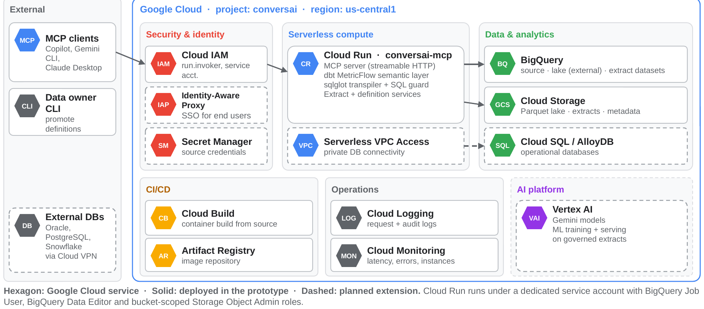

# ConversAI

**Conversational analytics over a governed semantic layer, served as an MCP server on Google Cloud Run.**

> **Try it now:** the live MCP endpoint is
> **`https://conversai-mcp-w73zfflpqq-uc.a.run.app/mcp`** (streamable HTTP, no login required during evaluation).
> Open this repository in VS Code: `.vscode/mcp.json` already points at it. Step-by-step instructions, a test script
> with expected answers, and offline benchmark steps are in **[docs/EVALUATION.md](docs/EVALUATION.md)**.

Ask a business question in natural language from any MCP client (GitHub Copilot in VS Code, Gemini CLI, Claude
Desktop). The LLM never writes SQL: it calls MCP tools and resolves the question to metrics and dimensions
defined once in a semantic layer using MetricFlow. The semantic query is compiled deterministically, transpiled to
the SQL dialect of the connected source (BigQuery, a Cloud Storage data lake, DuckDB, Oracle), checked for safety, and executed only after the user approves it.



## The problem

In data-driven organisations, answering a single business question requires an analyst to write a sequence of SQL
queries against tables whose business meaning is undocumented. Stakeholders wait in the analyst queue, the same
metric is computed differently by different people, and AI text-to-SQL tools guess at meaning from column names,
producing numbers that cannot be audited.

## What ConversAI does

| Capability | How |
|---|---|
| Conversational Q&A over MCP | 18 MCP tools (`list_metrics`, `search_catalog`, `run_semantic_query`, ...) usable from any MCP client |
| Unified semantic layer | One definition per metric and dimension, with synonyms (`semantic/models/*.yml`) |
| Deterministic SQL | MetricFlow compiles the semantic query; sqlglot transpiles it to each engine's dialect |
| Human in the loop | MCP elicitation dialog shows the plain-English meaning, the SQL and a cost estimate (BigQuery dry run) before execution |
| Engine-agnostic | Logical tables are bound per target in `targets.yaml`; the semantic layer never changes |
| Scoped extracts | "Export this" materialises the data behind an answer (BigQuery table or Parquet/CSV); follow-ups run on the extract, with out-of-scope warnings |
| Proposed definitions | When a concept is missing, the LLM proposes a definition; the server validates it (expression whitelist, MetricFlow compile, dry run) and a person approves it; answers are labelled provisional until a data owner promotes it |
| Guardrails | Read-only SQL guard, per-query maximum-bytes-billed cap, approval before execution |

## How Cloud Run is used

* `mcp_server.py` runs as a **Cloud Run service** (`conversai-mcp`) exposing MCP over **streamable HTTP** at `/mcp`.
* Built from source with `gcloud run deploy --source .`: **Cloud Build** builds the `Dockerfile` and the image is
  stored in **Artifact Registry**. The semantic manifest is compiled at build time.
* **Access:** deployed IAM-protected by default (`--no-allow-unauthenticated`, callers need `roles/run.invoker`,
  connecting through `gcloud run services proxy`). For the evaluation it is opened as a **public demo**
  (`allUsers` invoker, `CONVERSAI_PUBLIC_DEMO=1`, see `deploy/make_public.cmd`). Server-side guardrails stay on:
  clients can only send semantic queries made of governed names, SQL is generated by the server and checked
  read-only, each query has a bytes-billed cap, and deleting extracts is disabled.
* Runs as a dedicated **service account** with least privilege: BigQuery Job User, BigQuery Data Editor, and Storage
  Object Admin on the project bucket only.
* `--max-instances 1 --session-affinity` keeps each MCP conversation on one instance (per-conversation state such as
  the active extract); `--timeout 3600` supports long-lived MCP sessions; the service **scales to zero** when idle.
* Configuration through environment variables: `CONVERSAI_TARGETS=bigquery,gcs_lake`,
  `CONVERSAI_DEFAULT_TARGET=bigquery`, `CONVERSAI_EXPORT_DESTINATION=bigquery`,
  `CONVERSAI_REGISTRY=gs://<bucket>/conversai/exports.json` (extract registry and definitions log on Cloud Storage,
  written with generation-match preconditions so concurrent writers never overwrite each other).
* Data: **BigQuery** (`conversai_source` tables, `conversai_lake` external tables over Parquet in **Cloud Storage**,
  `conversai_exports` extracts with a 7-day expiry). Every query job is labelled `app=conversai`; requests are
  logged in **Cloud Logging**.

## Repository layout

| Path | Contents |
|---|---|
| `mcp_server.py` | MCP server (stdio locally, streamable HTTP on Cloud Run) |
| `engine/` | Catalog, MetricFlow compiler, dialect binding/transpilation, executors, extracts, proposed definitions |
| `semantic/` | dbt project: semantic models, 37 governed metrics, column notes |
| `targets.yaml` | Physical bindings per engine: DuckDB warehouse, Parquet lake, BigQuery, Cloud Storage lake, Oracle |
| `tables/` | Synthetic dataset generator (seeded), split checks, BigQuery / Cloud Storage loader |
| `eval/` | 29 benchmark questions, gold answers with independent hand-written SQL, evaluation runner |
| `tests/` | 48 tests, including in-memory BigQuery and Cloud Storage emulators |
| `deploy/` | Cloud Run deployment, public-demo switch, start script, health check, BigQuery inspection |
| `cli.py` | Command line: catalog, sql, query, compare, ask, export, definitions |
| `.vscode/mcp.json` | Points VS Code at the live Cloud Run endpoint |
| `.github/agents/` | VS Code Copilot agent restricted to the ConversAI tools |
| `docs/` | Evaluation guide, architecture diagram, detailed local guide |

## Run it locally (no cloud needed)

Requires Python 3.11 to 3.13.

```bash
python -m venv .venv
.venv\Scripts\activate            # Windows   (macOS / Linux: source .venv/bin/activate)
pip install -r requirements.txt pytest
python tables/build_tables.py     # synthetic data: 5,000 accounts x 12 monthly cycles (seeded, ~1 minute)
python eval/run_eval.py           # gold benchmark: expect 54 passed
python -m pytest -q tests         # expect 48 passed
python cli.py query @examples/dq30_trend.json --target warehouse --yes
```

To use the local server from VS Code, copy `.vscode/mcp.local.example.json` into `.vscode/mcp.json` and set your
paths.

## Deploy to your own Google Cloud project

```bat
set GCP_PROJECT=your-project-id
gcloud auth login
gcloud auth application-default login
python tables\load_bigquery.py --lake     :: BigQuery source tables + Parquet lake on Cloud Storage
deploy\gcp_deploy.cmd                     :: APIs, service account, IAM, Cloud Build + Cloud Run deploy (private)
deploy\start_cloud.cmd                    :: authenticated proxy on localhost:8080 + health check
deploy\make_public.cmd                    :: optional: public demo mode (deploy\make_public.cmd close to revert)
```

## Benchmark results (demo dataset)

| Benchmark | Result |
|---|---|
| Execution accuracy: semantic layer vs independent hand-written SQL | 54 / 54 (27 questions x 2 engines) |
| Natural-language questions resolved to the correct semantic query (Claude) | 27 / 27 |
| Extract vs source, within the extract's scope (BigQuery) | 0 real differences |
| Unsafe proposed definitions rejected | 18 / 18 |
| Compile latency (in-process MetricFlow) | ~0.04 s |
| BigQuery bytes scanned per question | 1.9 to 3.9 MB |

The dataset is synthetic (a credit-card portfolio: 5,000 accounts, 59,801 billing cycles, 12 months), generated by
`tables/build_tables.py` with a fixed seed, so every number above is reproducible.

## Design principle

The LLM resolves intent, deterministic engines generate SQL, and humans authorise execution.
